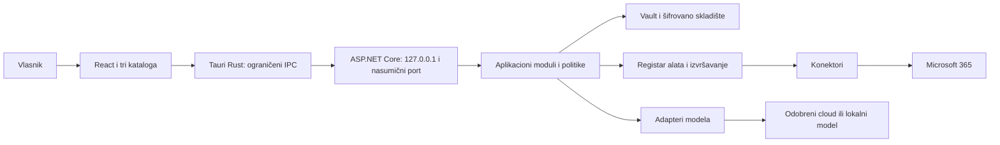

# Arhitektura — Personal AI Agent

- **Datum:** 11.10.2026. (`2026-10-11`)
- **Verzija:** 1.1; dopuna pamćenja teme i UX predaje 12.10.2026.
- **Izvori:** [PRD 1.1](prd.md), [početni plan](../codex-plan/00_START_HERE.md), [odluke](../codex-plan/DECISIONS.md), [I18N_SPEC 1.2](../codex-plan/I18N_SPEC.md), [AGENTS.md](../../AGENTS.md), [ADR-001](../architecture/ADR-001_LOCALIZATION.md), [ADR-005](../architecture/ADR-005_THEME_PERSISTENCE.md).
- **Status:** Projektantska razrada cijelog MVP-a 01–09; STORY-024 je završena uz Windows provjeru praznog lokalizovanog shell-a. [Izvještaj](../architecture/STORY-024_WINDOWS_VERIFICATION.md) sadrži dokaze i granice. Aplikacija u cjelini nije implementirana.
- **Aktivna implementaciona faza:** Faza 01, izričito aktivirana zahtjevom vlasnika 12.10.2026. Njen detaljni fajl je pročitan pri aktivaciji; ostali detaljni fajlovi faza nisu učitavani. Ova arhitektura ne zamjenjuje pojedinačne kriterijume faze.
- **Provjera spremnosti:** [gate-check.md](gate-check.md); odluka `CONDITIONAL PASS` odnosi se na planiranje, uz preduslove iz odjeljka 11.

## 1. Pregled sistema <!-- System Overview; architectural drivers; constraints -->

Jedan vlasnik upravlja jednom privatnom Windows 11 x64 instancom. Lokalno se čuvaju razgovori, postavke, izvori, nacrti, memorija, zadaci i evidencija. Microsoft 365 i izabrani modeli dostupni su isključivo preko backend adaptera. Vlasnik određuje naloge, podatke, dozvole i vanjske promjene.

Arhitektonski pokretači su zaštita tajni, početno zaključan vault, provjerljiva autorizacija, tri lokalizacije od prvog builda, očuvanje podataka i nezavisnost od AI provajdera. Prioriteti vlasnika su važna pošta, uredljivi odgovori i podsjetnici. Rok, kapacitet, količina stvarnih podataka i brojčani ciljevi nisu dogovoreni.

MVP nema javni/LAN API, cloud sinhronizaciju, više vlasnika iste instance, proizvoljne komande, direktni SQL alat, autonoman browser/desktop control ili tajne poslove dok je vault zaključan. Kasniji udaljeni pristup zahtijeva novu sigurnosnu procjenu.



Privatni sadržaj u rendereru ograničen je na trenutno otključan korisnički prikaz. Renderer ne dobija sačuvane ključeve, OAuth tokene, SQL konekciju ili provajder SDK. Unesena nova lozinka/ključ prolazi kroz jednokratni unos bez trajnog čuvanja u UI stanju, localStorage, dijagnostici ili logovima.

## 2. Arhitektonski obrazac <!-- Architecture Pattern; layered modular monolith -->

Izabran je **modularni monolit** u .NET sidecar procesu, sa slojevima `Domain → Application ← Infrastructure`, uz `Api` kao ulaz i sastavljanje zavisnosti. Domenski i aplikacioni sloj definišu portove; infrastruktura ih implementira. Tauri Rust sloj upravlja životnim ciklusom i ograničenim transportom; ne preuzima poslovne ili kriptografske odluke.

Nivo BMAD projekta 3 opisuje opseg, ne zahtijeva mikroservise. Jedna instalacija, jedan vlasnik i lokalne transakcije opravdavaju monolit: jednostavnije izdanje, manje mrežnih granica i jedno mjesto za lock/dozvole. Cijena je zajednički proces i pažljivo upravljanje memorijom/poslovima. Granice se provjeravaju referencama projekata i ugovornim testovima, bez distribuiranog brokera, event sourcing-a ili proizvoljno učitanih dodataka.

Osnovna struktura je dodana kroz STORY-024, a zaštićeni health transport kroz završenu STORY-025. Storage i poslovni adapteri još nisu implementirani. [Windows izvještaj](../architecture/STORY-025_WINDOWS_VERIFICATION.md) bilježi lokalne transportne dokaze i vlasnikovu manuelnu potvrdu AC-06 od 12.10.2026; lifecycle/stream i installer ostaju preostali obim. Usklađivanje tokom sprint planiranja 12.10.2026. prati mjerodavne nazive i razdvajanje aplikacija iz Faze 01; granice slojeva ostaju iste:

```text
apps/web/                    React, TypeScript strict, locales/
apps/desktop/src-tauri/       Rust shell, capabilities, sidecar lifecycle
src/PersonalAI.Domain/       Entiteti i obavezni interfejsi Faze 01
src/PersonalAI.Application/  Slučajevi upotrebe i dodatni aplikacioni portovi
src/PersonalAI.Infrastructure/ SQLCipher, kriptografija, adapteri u kasnijim fazama
src/PersonalAI.Api/          Lokalni HTTP, DTO i composition root
tests/PersonalAI.UnitTests/
tests/PersonalAI.IntegrationTests/
tests/PersonalAI.SecurityTests/
docs/architecture/          ADR i budući dokazi implementacije
```

Svaki modul posjeduje svoje entitete i upise. Jedna SQLCipher baza omogućava zajedničku transakciju za odobrenje, zauzimanje izvršavanja i audit. Poslovni moduli ne koriste tuđe tabele direktno; čitanja kroz portove daju kontrolisane projekcije. Implementacija se dodaje samo u izričito aktiviranoj fazi.

Faza 01 propisuje interfejse IAIProvider, IProviderRegistry, ISecretVault, IConversationStore, IToolRegistry, IApprovalService, IIntegrationConnector, IMemoryService, IJobScheduler i ISettingsStore. Projektantske nazive poput IModelProvider/IScheduler iz naredne tabele treba uskladiti sa tim ugovorima, bez duplih ekvivalentnih apstrakcija. Dodatni autentifikacioni port ostaje odvojen. [Uslovni plan sprinta](sprint-plan.md) razlaže samo osnovu; ovo usklađivanje nije nova odluka o transportu, aktiviranje faze ili implementacioni dokaz.

## 3. Komponente i ugovori <!-- Component Design; interfaces; contracts -->

| Komponenta | Odgovornost i podaci | Pruža / zahtijeva | Glavni zahtjevi |
|---|---|---|---|
| `DesktopShell` | Pokretanje sidecara, instance lock, izbor fajla, sleep i privatna obavještenja | `IDesktopTransport`, `IFileSelectionBroker`; lokalni API | FR-001, FR-025, FR-028; NFR-001/003 |
| `LocalizationSettings` | Validacija jezika, kanonske postavke i bootstrap kopija | `ISettingsService`, `IBootstrapLocaleStore`; storage | FR-024/025; NFR-007/008 |
| `SessionAuthentication` | Procesna sesija, token, Origin/Host i transport | `ISessionAuthenticator`; privatni startup kanal | NFR-001 |
| `Vault` | Uspostavljanje, unlock/lock, ključevi, recovery i lease | `IVaultService`, `ISecretVault`; provjeren crypto/native build | FR-002/003; NFR-002 |
| `StorageRecovery` | SQLCipher, transakcije, migracije, backup/restore i šifrovani fajlovi | `IUnitOfWork`, ograničeni repositories, `IBackupService`; vault | FR-004; NFR-006 |
| `ModelGateway` | Sposobnosti modela, generisanje/stream, embeddings, usage i rezervni model | `IModelProvider`, `IUsagePolicy`; vault, cloud politika | FR-005/006/026; NFR-005/012 |
| `AgentOrchestrator` | Razgovor, istorija, izbor konteksta i jezička instrukcija | `IAgentService`; modeli, retrieval, registar alata | FR-007/013; NFR-004 |
| `ToolExecution` | Registrovani alati, validacija, dozvole, pregled i ishod | `IToolRegistry`, `IToolExecutor`, `IPermissionService`, `IApprovalService`; konektori | FR-008/009/014/027 |
| `ConnectorAuthentication` | OAuth, token cache i opoziv naloga | `IConnectorAuthenticator`; vault, sistemski browser | FR-010 |
| `Microsoft365Connector` | Straničenje/sync i autorizovane mutacije izvora | `IMailConnector`, `ICalendarConnector`, `ITaskConnector`, `IDocumentConnector`; OAuth | FR-011/014–017 |
| `MailWorkspace` | Pravila, oznake, AI preporuka i lokalni nacrti | `IMailImportanceService`, `IDraftService`; connector, agent | FR-012/013 |
| `DocumentsMemory` | Uvoz, verzije, odlomci, retrieval i odobrena memorija | `IDocumentImporter`, `IRetrievalService`, `IMemoryService`; storage, modeli | FR-018–020 |
| `TasksScheduler` | Lokalne obaveze, termini, jedan naknadni pregled i deduplikacija | `ILocalTaskService`, `IScheduler`, `IClock`; status izvora, vault | FR-021–023; NFR-009 |
| `AuditDiagnostics` | Ishodi, minimalni tehnički zapisi i redigovani izvoz | `IAuditSink`, `IDiagnosticsExporter`; storage, UI pregled | FR-027/028 |

Ugovori su na engleskom, verzionisani i nezavisni od SDK tipova. Sadrže `CancellationToken`, stabilne identifikatore, sposobnosti adaptera, strukturisane greške i eksplicitno stanje nepotpunog/nepoznatog rezultata.

- `IModelProvider.GenerateAsync(ModelRequest, CancellationToken)` vraća tok `ModelEvent`: `delta`, `toolProposal`, `usage`, `completed`, `failed`. Prijedlog nije izvršavanje; adapter ne dobija konektor ni dozvolu.
- `IModelProvider.GetCapabilitiesAsync` razlikuje chat, streaming, tools i embeddings. Nepodržana sposobnost daje `MODEL_CAPABILITY_UNSUPPORTED`; ne emulira se proizvoljnim izvršavanjem.
- `ISecretVault.UseSecretAsync(SecretId, VaultLease, operation)` koristi tajnu unutar backend adaptera bez vraćanja plaintext-a poslovnim DTO/rendereru. Tajne se ne šalju u model request.
- Konektori imaju odvojeno `ReadPageAsync`, `RefreshStatusAsync` i tipizovane mutacije sa `ExecutionContext`. Rezultat nosi `sourceId`, `sourceVersion`, `observedAtUtc`, `freshness` i status ishoda.
- `IToolExecutor.ExecuteAsync(ActionId, ApprovalId, CancellationToken)` učitava sačuvane argumente; klijent ne dostavlja zamjenske argumente pri izvršavanju.
- Storage portovi primaju entitete/specifikacije upita, nikad proizvoljan SQL ili putanju baze iz UI/modela.

### 3.1. Životni ciklus vaulta i konkurentnost <!-- Security; reliability -->

`Uninitialized → Locked → Unlocking → Unlocked → Locking → Locked`; neuspjeh unlock-a ostaje `Locked`. Samo `Unlocked` izdaje kratkotrajni `VaultLease` vezan za monotonu `vaultEpoch`. Ne postoji diskovni ključ za automatsko otključavanje.

Lock prvo atomarno opoziva epoch, zaustavlja prihvatanje tajnih operacija i otkazuje aktivne tokove/poslove. Potom zatvara konekcije, čisti pool ako je ikad uveden i briše kontrolisane key/token buffere. Početni dizajn isključuje DB pooling. UI briše privatne prikaze, cache, otvorene nacrte, streaming fragmente i osjetljivo stanje; nema trajnog webview cache-a sadržaja.

Svaki adapter provjerava lease i dozvolu neposredno prije prenosa. Zaključavanje i početak prenosa serijalizuju se istim izvršnim guard-om. Poziv već poslat vanjskom servisu ne može se povući lock-om: prekid bez potvrđenog rezultata ostavlja `unknown`, a kasnija provjera traži unlock. Rezultat iz stare epoch ne vraća privatni sadržaj rendereru. UI aktivnost, potvrđena od lokalnog prozora, resetuje početnih 15 minuta; poslovi/AI tokovi ne održavaju vault otključanim. Sleep zaključava prije nastavka rada.

### 3.2. Dozvole, odobrenja i nepouzdan tekst

Alati se registruju iz paketa aplikacije, sa ID-jem, šemom argumenata, tipom rizika i potrebnim opsegom. Model ne može registrovati alat. Podrazumijevana dozvola je `deny`; provjera ide i pri planiranju i pred poziv. Dozvola za čitanje razlikuje se od dozvole za promjenu i politike prenosa podataka.

Mejl, dokument, memorija i rezultat alata imaju označeno porijeklo i tretiraju se kao podaci. Jezičke instrukcije i prava potiču iz pouzdanog profila/korisničkog unosa. Kontrolisano parsiranje, prikaz HTML-a bez skripti i backend politike sprečavaju da prompt injection postane izvršna instrukcija. Ne tvrdi se da sam sistemski prompt garantuje zaštitu.

Svaka vanjska promjena dobija `ActionProposal`, tačan pregled i izričitu jednokratnu potvrdu. Slanje/brisanje nemaju blanket izuzetak za automatizacije. Fingerprint obuhvata kanonski JSON argumenata, verziju alata, nalog, cilj, izvorni ETag/verziju, primaoce To/CC/BCC, sadržaj i hash priloga. Backend generiše pregled iz tih istih argumenata. `Approval` čuva fingerprint, važenje, epoch i verziju politike.

`proposed → awaitingApproval → approved → executing → succeeded | failed | unknown`; moguće su i `rejected`, `expired`, `cancelled`. Lock, opoziv, izmjena prijedloga ili novija verzija izvora poništavaju odobrenje. Zauzimanje akcije i potrošnja odobrenja su jedna DB transakcija sa jedinstvenim `executionKey`; ponovljen zahtjev dobija postojeći status.

Prije HTTP prenosa upisuje se namjera. Pad procesa između tog upisa i potvrde konzervativno daje `unknown`. Lokalna idempotentnost nije garancija tačno jednog vanjskog efekta. Ako API pruža idempotency ključ, koristi se dokumentovan mehanizam; inače nema automatskog retry-a mutacije. Graph prihvatanje slanja nije dokaz isporuke primaocu. Provjera izvora razlikuje prihvaćeno, potvrđeno i nepoznato; ako dokaz nije dostupan, stanje ostaje nepoznato.

### 3.3. Politika modela, cloud podataka i troška

`DataProcessingGrant` obuhvata tačno odredište/provajdera, nalog i izabrane resurse, vrste sadržaja, svrhu (`chat`, `draft`, `classification`, `embedding`) i važenje. Početno nema prenosa privatnih izvora. UI prije odluke pokazuje kontekst i odredište; odobrenje jednog dokumenta ne daje pristup cijelom nalogu. Embeddings koriste istu politiku. Opoziv djeluje na nove pozive i otkazuje aktivne gdje je moguće.

Primarni i rezervni model koriste isti gateway. Rezervni se poziva samo ako njegova politika pokriva isti kontekst i svrhu i korisniku se prikaže promjena. Ne prenosi se ključ prvog provajdera drugom. Nedostupna AI obrada ostavlja lokalni pregled, pravila i označen nacrt/stanje.

Backend validira kompatibilne URL-ove: HTTPS za cloud; HTTP samo za posebno odobren lokalni model na loopback-u. Blokira credentials u URL-u, neodobrene adrese/portove, neočekivana preusmjerenja i prenos Authorization zaglavlja drugom origin-u. DNS/IP i cilj se provjeravaju pri povezivanju, uz zaštitu od rebinding-a; ne šalje se sadržaj ako bezbjedna provjera nije dostupna.

Upotreba bilježi tokene/jedinice i porijeklo `measured | estimated | unknown`. Početna projektantska opcija limita je broj zahtjeva u UTC danu; tokeni i novčani limit nude se tek sa pouzdanom jedinicom i verzionisanim cjenovnikom. Rezervacija prije poziva sprečava konkurentno prekoračenje, a nepoznat trošak se ne računa kao nula. Konačnu ponudu limita treba uskladiti sa aktivnim fazama 03/08; nema tvrdnje o tačnom računu provajdera.

### 3.4. Microsoft 365, izvori i važnost pošte

Public client OAuth authorization code sa PKCE koristi sistemski browser, jednokratni `state`, provjeru redirect URI-ja i kratko trajanje login pokušaja. Backend posjeduje verifier i token cache, šifrovan u vaultu. Nema aplikacionog client secret-a u desktop paketu. Opoziv veze zaustavlja povezane poslove i označava cache zastarjelim.

Planirana delegirana prava uvode se postepeno po funkciji: `Mail.Read` za sadržaj pošte, `Mail.Send` za slanje, `Mail.ReadWrite` tek za odobreno brisanje/vanjske nacrte; `Calendars.Read`/ `Calendars.ReadWrite`, `Tasks.Read`/ `Tasks.ReadWrite`, `Files.Read` za podržane OneDrive izvore. `offline_access` je potreban samo za odobren refresh tok. Prava ne zamjenjuju interne dozvole niti daju neograničen opseg. Konačna matrica i podrška za privatni/poslovni nalog provjeravaju se u fazi 05; nema fallback-a na application permissions ili šira prava.

Sync prati zaseban cursor po nalogu/resursu, verziju i posljednji uspjeh. Straničenje ima granice; `nextLink` i download URL su nepouzdani i validiraju se prema connector politici. Token ide samo odobrenom Graph hostu; privremeni download URL ne dobija Graph token. Izvorni status ima prednost nad lokalnom kopijom; neuspješan refresh ne označava kopiju aktuelnom. ETag/precondition ili ponovna provjera prije mutacije sprečava tiho prepisivanje novijeg stanja.

Važnost je deterministična: ručna oznaka → prvo primjenjivo korisnički poredano pravilo → odvojena AI preporuka. Početna polja su pošiljalac, domen i tema, sa ograničenim doslovnim/prefix/contains operatorima; nema proizvoljnog izvršnog izraza. Promjena pravila mijenja pregled, ne izvorni mejl. Puna dostupna pošta i neprocijenjene stavke ostaju dostupne.

Nacrt se čuva lokalno, sa verzijom originala i izabranim kontekstom. Uređivanje stvara novu verziju i poništava odobrenje. Vanjski draft je zasebna autorizovana mutacija. Kalendar čuva izvorni zonalni podatak i razlikuje cjelodnevni datum od trenutka. To Do zadržava nalog, identitet i potvrđen status.

### 3.5. Dokumenti, indeksi i memorija

Uvoz prihvata samo fajl odabran kroz desktop broker; backend dobija kratkotrajni capability vezan za tačno odabrani fajl, bez proizvoljne putanje. Reparse/symlink izlazak iz odobrenog opsega odbija se. Parser ima limite veličine, vremena, broja odlomaka i dekompresije; ne izvršava makroe, skripte ili mrežne reference. Tačan spisak formata i brojne vrijednosti limita ostaju uslov faze 06; nepodržano se odbija.

Izvor, verzija, hash sadržaja i verzija parsera određuju duplikat. Uspjela nova verzija atomarno postaje aktivna nakon obrade u izolovanom radnom prostoru; neuspjeh čuva staru. Originalni lokalni fajl je van odgovornosti aplikacionog šifrovanja; njene kopije, odlomci i indeksi su šifrovani.

Početna pretraga koristi SQLCipher FTS indeks i filtriranje dozvoljenih aktivnih verzija. Embeddings su dodatna sposobnost iza porta i politike; odlaganje native vektorskog paketa ne odlaže obaveznu pretragu i izvore. Svaki odgovor nosi `documentId`, `versionId`, `chunkId` i lociranje strane/odlomka gdje format omogućava. Odsustvo dokaza jasno se navodi.

Memorija početno radi sa pojedinačnim odobrenjem prijedloga. Isključivanje blokira nove upise, a odobrena činjenica zadržava porijeklo. Credential podaci nikad nisu kandidati memorije. Brisanje dokumenta/memorije uklanja aktivne izvore, FTS, embeddings i cache u transakciji/oporavljivom poslu; prije upita se ponovo provjerava tombstone. Kopije u ranijim offline backupima ne mogu se retroaktivno izbrisati. Fizičko bezbjedno brisanje sektora na SSD-u nije obećano.

### 3.6. Zadaci, raspored i vremenske granice <!-- Performance; scalability; reliability -->

Lokalni i To Do zadaci imaju različit identitet i zajedničku read projekciju. Rok je `instant`, `dateOnly` ili `none`; čuva se i porijeklo/zone podatak. Lokalni datum bez vremena prikazuje konvenciju kraja dana: rok je granica početka sljedećeg lokalnog dana, a zadatak kasni od te granice. Izvorni zonalni rok se ne mijenja zbog UI jezika. Predloženi zadatak iz mejla traži potvrdu teksta/roka, uz jedinstveno porijeklo koje sprečava automatski duplikat.

Raspored čuva lokalno vrijeme, korisničku zonu, verziju podešavanja i posljednji obrađen termin. Backend razrješava zonu na Windows-u kroz provjerenu mapu i ne pogađa pri nepodržanom ID-ju. `IClock` daje UTC za podobnost i monotono vrijeme za timeout/neaktivnost.

- Mejl ulazi kada je potvrđeno nepročitan i `receivedAtUtc < nowUtc - 72h`; tačno 72 sata ne ulazi.
- Potvrđeno nezavršen zadatak sa trenutnim rokom ulazi ako `dueAtUtc < nowUtc` ili `nowUtc <= dueAtUtc <= nowUtc + 24h`. Zadaci bez roka su samo u opštem pregledu.
- Važna i ostala podobna pošta prikazuju se odvojeno, bez skrivanja neprocijenjenih stavki. Odgađanje mijenja `snoozedUntilUtc`, ne rok/status izvora.
- Termin je jedinstven po `(scheduleId, scheduleVersion, localDate)`. Na proljećnom DST preskoku koristi se prvi važeći lokalni trenutak poslije izabranog nepostojećeg vremena; u jesenjem ponavljanju raniji od dva UTC trenutka. Isti lokalni dan ima najviše jedan dnevni pregled.
- Promjena zone/vremena ne vraća već obrađen termin istog dana radi još jednog pregleda; verzije se povezuju sa evidencijom potrošenog lokalnog dana. Promjena aktivira raspored tek nakon upisa i ne mijenja stvarne trenutke postojećih događaja.
- Pri unlock/start-u računa se da li postoje propušteni termini. Svi se objedine u jedan `catchUp` pregled sa novim snapshot-om aktuelne podobnosti, uz watermark do posljednjeg dospjelog termina. Dnevni i naknadni posao ne rade paralelno za isti raspored.
- Jedinstveno `(digestId, sourceKind, accountId, sourceId)` sprečava duplikat stavke unutar pregleda. Podobna stavka smije ponovo biti u narednom dnevnom pregledu.

Poslovi imaju `queued | running | waitingForUnlock | missed | completed | failed | cancelled`. Scheduler se inicijalizuje tek poslije unlock-a; dok je zaključano nema čitanja rasporeda iz baze ili tajnih poziva. Već učitani tajni podaci brišu se pri lock-u. Propušteni termini se izvode iz evidencije poslije unlock-a, bez čuvanja privatnog rasporeda u bootstrap-u.

Prije podsjećanja provjeravaju se izvorni statusi. Nedostupan izvor daje nepotpun pregled sa vremenom posljednjeg osvježavanja i odvojenu zastarjelu projekciju; ona nije potvrđeni novi podsjetnik. Potvrđena lokalna obaveza može biti u pregledu i bez mreže.

Upis digesta i notification outbox-a je transakcioni. Isti notification ID se ažurira pri ponovnom pokušaju, bez novog digesta; OS isporuka nije obećanje tačno jednom. Zaključavanje prije prikaza prebacuje sadržaj na generičko lokalizovano obavještenje. Naknadni pregled sadrži samo čitanje/podsjećanje, nikad slanje/brisanje.

Read/sync retry je ograničen, sa backoff-om, jitter-om, poštovanjem `Retry-After` i ukupnog roka. Mutacije nemaju slijepi retry. Početno jedan aktivan chat i jedan zahtjevan import po instanci, ograničena sync konkurentnost po nalogu, ograničeni red i backpressure. Limiti se kalibrišu u relevantnoj fazi; UI stream/otkazivanje ne čekaju završetak indeksiranja.

## 4. Model podataka i šifrovano čuvanje <!-- Data Model; database; entities; schema -->

ID-jevi su opaque identifikatori; svaki zapis pripada instanci/vlasniku. Veze provjeravaju FK i pripadnost. Datumi prenosa su ISO 8601 UTC; date-only je zaseban tip, ne proizvoljni ponoćni UTC. Sve naredne tabele su **planirana šema**, bez izvršene migracije.

| Entiteti / ključ | Bitni podaci i veze | Invarijante i indeksi |
|---|---|---|
| `UserSettings(OwnerId, Key)` | `ValueJson, Revision, UpdatedAtUtc`; uključuje `ui.locale`, `agent.responseLanguage`, `ui.theme` | Validirana šema; puni locale kodovi; tema `light | dark` |
| `ProviderProfiles(Id)`, `Secrets(Id)` | Tip, odredište, model, capabilities; šifrat, nonce, tag, keyVersion | Profil referiše SecretId; DTO bez plaintext-a |
| `Accounts(Id)`, `OAuthTokenCache(AccountId)`, `SyncCursors(AccountId, Resource)` | Delegirana prava, stanje veze; šifrovani cache; cursor, refresh vrijeme | Jedinstven nalog/izvor; tajna polja dodatno AEAD |
| `Conversations(Id)`, `Messages(Id)` | Provider/model, jezik, redoslijed, sadržaj, completion status | FK i `(ConversationId, Sequence)` |
| `Permissions(Id)`, `DataProcessingGrants(Id)` | Tool/resource scope, destination, purpose, revision/expiry | Default deny; opoziv/revizija invalidiraju plan |
| `ActionProposals(Id)`, `Approvals(Id)`, `Executions(Id)` | Konačni argumenti, fingerprint, epoch, executionKey, ishod | Jedinstven executionKey; atomic claim; privatni pregled samo šifrovan |
| `MailItems(AccountId, SourceId)`, `MailLabels`, `MailRules(Id)`, `MailAssessments`, `Drafts(Id)` | SourceVersion, receivedAt, unread, freshness; prioritet pravila; revision nacrta | `(AccountId, IsRead, ReceivedAtUtc)`; preporuka odvojena od odluke |
| `CalendarItems(AccountId, SourceId)`, `RemoteTasks(AccountId, SourceId)` | Izvorna zona/date-only, ETag, status i observedAt | Status/verzija iz izvora; upiti po roku |
| `DocumentSources(Id)`, `DocumentVersions(Id)`, `DocumentChunks(Id)`, `SearchIndex` | Porijeklo, hash, parserVersion, lociranje, tekst; opciono embeddings | Aktivna verzija, tombstone; FTS u šifrovanoj bazi |
| `MemoryProposals(Id)`, `MemoryItems(Id)` | Tekst, izvor, decision, revision i deletion status | Samo odobrene aktivne stavke u kontekstu |
| `LocalTasks(Id)`, `TaskOrigins` | Status, dueKind/value/zone, confirmedBy, source | Jedinstveno potvrđeno porijeklo; deadline indeks |
| `Schedules(Id)`, `JobRuns(Id)`, `Digests(Id)`, `DigestItems`, `NotificationOutbox` | LocalTime, zone, revision, watermark, state; snapshot | Jedinstven termin/stavka/outbox ID |
| `UsageRecords(Id)`, `UsageReservations(Id)`, `AuditEvents(Id)` | Provider, minimalne jedinice, provenance; akcija, odluka, ishod | Bez prompta u usage/logu; vremenski indeks |
| `SchemaMigrations(Version)` | Checksum, compatibleRange, appliedAtUtc | Nepodržana verzija odbijena prije upisa |

Osnovne relacije: `Account → Mail/Calendar/RemoteTask/DocumentSource`; `Conversation → Message → ActionProposal → Approval/Execution`; `DocumentSource → Version → Chunk`; `Schedule → JobRun → Digest → DigestItem`. Indeksi i privatne kopije su dio šifrovane površine, uključujući WAL/journal/temp.

### 4.1. Ključevi, recovery i trajni fajlovi

Svaka instanca ima sopstveni nasumični `VaultRootKey`. Od njega se standardnim HKDF odvajanjem izvode zasebni ključevi za SQLCipher, AES-GCM tajne i šifrovane dokument/blob fajlove. Root je omotan password ključem izvedenim Argon2id-om sa nasumičnim salt-om; recovery omot koristi nezavisan nasumičan visokentropijski kod. Descriptor sadrži samo verzionisane KDF parametre, salt, nonce, tag, instance/generation ID i omotane ključeve, bez plaintext ključa.

AES-GCM koristi 256-bitni ključ, 96-bitni nonce i 128-bitni tag; nonce se ne ponavlja pod istim ključem, a AAD vezuje instance ID, entitet/polje, verziju i svrhu. Koriste se provjerene primitive, nikad sopstvena implementacija algoritma. KDF parametri i biblioteka se konačno utvrđuju poslije čitanja aktivne faze 02 i mjerenja ciljnog uređaja; nema snižavanja ispod dokumentovanog bezbjednog minimuma. Neautentifikovani descriptor ima striktne granice parametara radi zaštite od iscrpljivanja memorije.

Upotreba recovery koda zahtijeva novu lozinku i zamjenski kod, te rotaciju root-a i svih izvedenih ključeva u novoj generaciji: rekey baze, ponovna zaštita tajni/blobova i provjera integriteta. Stari kod ne otključava **aktuelnu** generaciju. Stara kopija/backup sa starim omotom nije retroaktivno opozvana; ova granica se objašnjava korisniku. Promjena lozinke najmanje atomarno zamjenjuje password omot; ako je stari key materijal kompromitovan, potreban je pun rekey.

Za višefajlne promjene koristi se staging generacija i provjeren preklop aktivnog manifesta, uz flush i procesni instance lock. Prekid prije commit-a zadržava staru generaciju; poslije commit-a otvara se kompletna nova. Manifest ne omogućava čitanje tajni i ne prima putanju iz UI. Windows crash-consistency, recovery rotacija i scenariji prekida ostaju kritičan uslov faze 02, bez tvrdnje da su već dokazani.

Instance direktorijum ima restriktivan ACL za vlasnika procesa i zasebne poddirektorijume za bootstrap, vault generacije, šifrovane blobove i redigovanu dijagnostiku. Aplikacija odbija reparse putanje i pristup tuđoj instanci; ACL nije zaštita od već kompromitovanog istog OS naloga. Nema obaveznog DPAPI/Credential Manager-a.

SQLCipher runtime mora potvrditi native identitet/verziju i stvarno šifrovano otvaranje; sama uspješna `PRAGMA key` komanda nije dokaz. Ako biblioteka nije odgovarajuća, vault operacije su blokirane. Nema običnog SQLite bundle-a uz SQLCipher, plaintext fallback-a ili zapisivanja tajne u connection string log.

### 4.2. Migracije, backup i restore

Migracije su verzionisane, transakcione gdje SQLite to omogućava, uz checksum i provjeru podržanog raspona. Destruktivna/promjena formata traži provjeren šifrovani backup i izričitu potvrdu. Povratak je samo kroz dokumentovanu kompatibilnu putanju ili obnovu prethodne kompletne generacije; nije obećan univerzalni `down`.

Backup se pravi uz dosljedan snapshot baze/blobova nakon zaustavljanja konkurentnih upisa, kroz podržanu SQLCipher putanju. Kontejner ima autentifikovani manifest i šifrovane sadržaje, obuhvata descriptor i sve potrebne blobove, bez plaintext export-a/ključa. Uključeni metapodaci za oporavak ne predstavljaju dekripcioni ključ bez password/recovery materijala.

Restore raspakuje samo u staging, sa zaštitom od path traversal-a i limita arhive. Provjerava autentifikaciju, pristupni materijal, format, kompletnost i integritet prije zamjene. Oštećen/noviji nepodržani backup čuva postojeću instancu. Zamjena zahtijeva backup i potvrdu; nova instanca dobija nov runtime identity, počinje zaključana i zahtijeva preispitivanje dozvola/naloga/poslova. Pending approvals i session tokeni nikad se ne obnavljaju kao važeći.

## 5. API i desktop transport <!-- API Specifications; REST; authentication; authorization -->

API je interni REST/JSON `/api/v1` sa engleskim DTO, error kodovima i verzijama. Rust shell je jedini UI klijent: renderer šalje tipizovane dozvoljene IPC operacije, Rust formira poznatu rutu i metodu. Nema generičkog proxy-ja koji prima URL, SQL, shell komandu ili proizvoljna zaglavlja. Isti backend provjerava argumente, prava i vault.

### 5.1. Startup i zaštita

1. Rust uzima instance lock, generiše CSPRNG sesijski token i startuje samo ugrađeni sidecar iz provjerene paketne putanje.
2. Token, session ID i ugovoreni transport Origin prenose se privatnim naslijeđenim stdin/pipe kanalom, bez argv/env/datoteke. Readiness stdout nosi samo PID, verziju protokola i izabrani port, bez tajni; ne prosljeđuje se kao opšti log.
3. Kestrel binduje `127.0.0.1:0`, pa prijavljuje stvarno dodijeljen port. Nema probanja slobodnog porta pa ponovnog bind-a ili fallback-a na `0.0.0.0`/LAN/IPv6.
4. Rust drži token u memoriji i dodaje `Authorization: Bearer …` i tačan session-bound `Origin`. Renderer ne dobija token ni pristup proizvoljnim HTTP odredištima. Rust provjerava pozivajući prozor i Tauri capability; backend ne vjeruje samom Origin-u kao autentifikaciji.
5. Sve stvarne API operacije, uključujući health, unlock, reads, writes i stream, traže važeći token i tačan Origin, a Host mora biti tačan `127.0.0.1:port`. Nedostajući/null/nepoznat Origin se odbija. CORS allowlist je ista stroga vrijednost, bez wildcard-a.
6. Standardni preflight nema bearer i može dobiti samo transportni odgovor za tačan Origin i ograničene metode/zaglavlja; nema podataka niti izvršavanja. Stvarni zahtjev uvijek mora proći autentifikaciju. Rust transport ne zavisi od browser preflight-a.
7. Gubitak roditeljskog kanala/izlazak shell-a zaključava i zaustavlja sidecar. Novi proces dobija novi token; stari token i odobrenja nisu prenosivi.

Session token autentifikuje lokalni desktop proces; nije unlock niti korisnička dozvola. Razvojni web server ne dobija automatski povjerenje iz release konfiguracije. CSP i capabilities dopuštaju samo lokalni ugrađeni UI i precizne IPC operacije. Remote sadržaj otvara se izvan privilegovanog webview-a. U fazi 01 treba dokazati pipe startup, Origin/Host politiku, lock lifecycle i streaming na stvarnom Windows/WebView2 okruženju.

OAuth redirect je zaseban kratkotrajni callback receiver na `127.0.0.1` sa nasumičnim portom i tačnom rutom, bez podataka/opštih API funkcija. Provjerava jednokratni state, PKCE/login pokušaj, rok i očekivanu metodu; gasi se poslije ishoda/lock-a. Browser protokol ne dobija izuzetak od token/Origin politike glavnog API-ja.

### 5.2. Grupe operacija

| Rute / metode | Ugovor i kontrola |
|---|---|
| `GET /health`, `GET /vault/status` | Minimalan status; sesija obavezna, bez privatnih podataka |
| `POST /vault/setup`, `/unlock`, `/lock`, `/recovery`, `/password` | Rate limit, jednokratan osjetljivi body, redakcija; recovery kontrolisan tok |
| `GET/PATCH /settings` | Unlock, validirana šema, revision/precondition; kanonski upis prije bootstrap kopije |
| `GET/POST/PATCH /providers`, `POST /providers/{id}/test` | DTO sa secretConfigured; unos/zamjena tajne bez vraćanja; odredište/politika |
| `POST /accounts/connect`, `POST /accounts/{id}/disconnect` | Kontrolisan OAuth/opoziv, bez tokena u odgovoru |
| `POST /conversations/{id}/turns`, `POST /runs/{id}/cancel` | Kontekst/jezik i dozvola; runId, streaming i epoch |
| `GET /runs/{id}/events` | Autentifikovan HTTP stream → Rust kanal; sequence, tip i redigovana greška |
| `POST /actions/propose`, `GET /actions/{id}`, `POST /actions/{id}/approve`, `/reject`, `/execute` | Backend pregled, fingerprint, single-use approval; bez zamjenskih execute argumenata |
| `GET /mail`, `/calendar`, `/tasks/remote`, `/drive` | Cursor/pageSize limiti, resource scope i freshness |
| `POST/PATCH /mail/rules`, `/mail/labels`, `/drafts` | Lokalne potvrđene izmjene; slanje/brisanje kroz actions |
| `POST /documents/import`, `POST /search`, `DELETE /documents/{id}` | File capability, limiti, aktivni izvori, potvrda lokalnog brisanja |
| `GET/POST/PATCH/DELETE /memory`, `/tasks/local`, `/schedules` | Unlock, validacija/odobrenje politike, revision i porijeklo |
| `GET /digests`, `/jobs`, `/usage`, `/audit` | Privatne projekcije samo uz unlock |
| `POST /backups`, `POST /restore/validate`, `POST /restore/commit`, `POST /diagnostics/export` | Odabir kroz broker; staging i pregled; eksplicitna potvrda zamjene |

Rute su projektantski ugovor grupa, ne gotov OpenAPI. Detaljni DTO, max body/pageSize i timeout utvrđuju se u aktivnoj fazi. API koristi ograničene JSON šeme, parametarske upite, optimistic concurrency i opaque cursore. `Idempotency-Key` vezan je za instancu/sesiju i fingerprint; promijenjen body pod istim ključem je konflikt.

Greška ima `code, parameters, correlationId, retryable`; nema SDK stack trace-a ili privatnog teksta. Primjeri su `VAULT_LOCKED`, `PERMISSION_DENIED`, `APPROVAL_STALE`, `EXECUTION_OUTCOME_UNKNOWN`, `SOURCE_UNAVAILABLE`, `PROVIDER_UNREACHABLE`. UI bira prevod iz kataloga. Streaming ne koristi token u URL-u; prekid/reconnect ne ponavlja turn ili mutaciju.

## 6. NFR i sljedivost <!-- Non-Functional Requirements Mapping -->

`Full` znači konkretno projektovanu kontrolu, cilj i plan provjere; ne izvršen test. `Partial` označava neprovjeren kritični izbor ili nepotvrđen cilj. Nijedan red nije dokaz ponašanja aplikacije.

| NFR | Status | Kontrola / cilj | Planirani dokaz |
|---|---|---|---|
| NFR-001 | Full | §5.1, loopback/token/Origin/Host, svi transporti | TC-101: bind, invalid/missing/stale token i Origin, preflight, stream/direct HTTP |
| NFR-002 | Partial | §3.1/4.1, SQLCipher + AEAD + Argon2id; native paket/KDF/rotacija još nisu dokazani | TC-102: cipher identity, tamper, wrong key, disk/WAL/temp/backup; uslov G-001 |
| NFR-003 | Full | §1/3/4.1/5, granica renderera i zasebne instance | TC-103: reference/build/IPC pregled, dva vaulta, putanje i reparse napadi |
| NFR-004 | Full | §3.1/3.2, default deny, fingerprint, lease i status unknown | TC-104: injection, promijenjeni argumenti, opoziv/lock trka, replay i nedozvoljen alat |
| NFR-005 | Full | §3.3/3.5, destination/resource/purpose grant i ograničen failover | TC-105: fake transport dokazuje nula prenosa pri odbijanju; embeddings/DNS/redirect |
| NFR-006 | Full | §4.2, staged generacije, transakcije i zabrana tihog downgrade-a | TC-106: prekid svake commit granice, restore, rollback gdje podržan |
| NFR-007 | Full | §7.1 i ADR-001, tri kataloga, semantički paritet/CLDR | TC-107: ključevi/placeholderi/plurals, format, HTML i tri E2E toka |
| NFR-008 | Full | §7.1, kanonski prioritet, stari saved locale i 12 kombinacija | TC-108: restart/update/restore, bootstrap greške i nekompatibilan downgrade |
| NFR-009 | Full | §3.2/3.6, unique termin, catchUp watermark, source freshness i DST | TC-109: DST/zone/clock, lock/restart, stale source, outbox i unknown mutacije |
| NFR-010 | Partial | §3.6/7/9, backpressure, FTS, indeksi; predloženi p95 ≤2s i cancel ≤1s | TC-110: 10.000 poruka/1.000 zadataka/100 dokumenata i jedan chat; uređaj/pragovi nisu potvrđeni |
| NFR-011 | Full | §7.1, fokus/tastatura, lokalizovane posljedice i različita stanja | TC-111: tastatura/pomoćne tehnologije kroz osnovne tokove i odobrenja |
| NFR-012 | Full | §2/3/7/9, portovi, .NET 10, strict, lockfiles i provjerene licence | TC-112: architecture/contract provjere, CI, dependency pregled i fazni dokazi |

### 6.1. FR → komponenta → rješenje → provjera

| FR | Vlasnik komponente | Arhitektonski dokaz | Budući paket |
|---|---|---|---|
| FR-001 | DesktopShell, LocalizationSettings | §1/5.1/7.1/9; privatni startup/onboarding, bez brisanja | TC-001 |
| FR-002 | Vault | §3.1/4.1; stanje, lease, password omot i lock | TC-002 |
| FR-003 | Vault | §4.1; recovery rotacija, zamjenski kod, bez bypass-a | TC-003 |
| FR-004 | StorageRecovery | §4.2; snapshot, staging i potvrda zamjene | TC-004 |
| FR-005 | ModelGateway | §3/3.3/7; više adaptera, BYOK i capabilities/test | TC-005 |
| FR-006 | ModelGateway | §3.3; endpoint trust i kontrolisani rezervni model | TC-006 |
| FR-007 | AgentOrchestrator | §3/3.1/5.2/7.1; istorija, cancellation i jezik | TC-007 |
| FR-008 | ToolExecution | §3.2; registry/schema/default deny/recheck | TC-008 |
| FR-009 | ToolExecution | §3.2; pregled, fingerprint i single-use izvršavanje | TC-009 |
| FR-010 | ConnectorAuthentication | §3.4/5.1; PKCE, vault cache, opoziv | TC-010 |
| FR-011 | Microsoft365Connector | §3.4/4/5.2; puna pošta, cursor, izvor/freshness | TC-011 |
| FR-012 | MailWorkspace | §3.4; oznaka/pravila imaju prednost, AI odvojeno | TC-012 |
| FR-013 | MailWorkspace, AgentOrchestrator | §3.3/3.4; izabran kontekst i verzionisan lokalni nacrt | TC-013 |
| FR-014 | ToolExecution, Microsoft365Connector | §3.2/3.4; send/delete potvrda i unknown bez retry-a | TC-014 |
| FR-015 | Microsoft365Connector | §3.4/3.6; zone/date-only, concurrency i odobrenje | TC-015 |
| FR-016 | Microsoft365Connector | §3.4; potvrđen To Do status i autorizovane promjene | TC-016 |
| FR-017 | Microsoft365Connector | §3.4/3.5; odabrani OneDrive opseg, verzija i bezbjedni URL | TC-017 |
| FR-018 | DocumentsMemory | §3.5; capability, stanja uvoza, limiti i verzije | TC-018 |
| FR-019 | DocumentsMemory | §3.3/3.5; retrieval/FTS, izvori i embeddings politika | TC-019 |
| FR-020 | DocumentsMemory | §3.5; prijedlog/odobrenje, porijeklo i uklanjanje indeksa | TC-020 |
| FR-021 | TasksScheduler | §3.6; lokalni/izvorni identitet, confirmed origin, dueKind | TC-021 |
| FR-022 | TasksScheduler | §3.6; 72h/24h granice, podešavanje i deduplikacija | TC-022 |
| FR-023 | TasksScheduler | §3.1/3.6; samo unlocked, jedan catchUp, freshness | TC-023 |
| FR-024 | LocalizationSettings | §7.1/ADR-001; tri UI/četiri AI, persistence | TC-024 |
| FR-025 | LocalizationSettings, DesktopShell | §3/3.6/7.1; postavke/revision, zona/retention, private notice | TC-025 |
| FR-026 | ModelGateway | §3.3/4; usage provenance, rezervacija limita | TC-026 |
| FR-027 | AuditDiagnostics | §3.2/4/9; statusi akcija, redakcija i izvoz | TC-027 |
| FR-028 | DesktopShell, AuditDiagnostics | §9; installer/update/restore i dokaz cijelog MVP-a | TC-028 |

FR pokrivenost: **28/28 = 100%** projektantskih vlasnika/pristupa. NFR: **10 Full, 2 Partial, 0 Missing**; formula BMAD obuhvata Full+Partial, pa je **12/12 = 100%**, uz **83,33% potpuno razrađenih**. Uslovi nepoznatih native/KDF detalja i mjerenja ostaju vidljivi.

## 7. Tehnologije, lokalizacija i podrška <!-- Technology Stack; rationale -->

| Sloj | Odluka i razlog | Podrška/licenca i ograničenje izbora |
|---|---|---|
| Desktop | Preuzeti Tauri 2/Rust, Windows 11 x64/WebView2 | Sidecar i capabilities prema [Tauri sidecar](https://v2.tauri.app/develop/sidecar/) i [capabilities](https://v2.tauri.app/security/capabilities/); konkretan patch i licence svih crates u fazi 01 |
| UI | Preuzeti React, TypeScript strict, i18next/react-i18next | Tri kataloga obavezna; verzije, upstream licence i compatibility matrica zaključavaju se u fazi 01 |
| Backend | Preuzeti ASP.NET Core/.NET 10 | .NET 10 je LTS prema [zvaničnoj politici podrške](https://dotnet.microsoft.com/en-us/platform/support/policy/dotnet-core); podržani patch/SDK i licence dependency grafa prije builda |
| DB | Preuzeti SQLCipher; ADO.NET adapter iza storage porta | [Zetetic .NET](https://www.zetetic.net/sqlcipher/sqlcipher-for-dotnet/) razdvaja native pakete i Microsoft.Data.Sqlite.Core; izbor distribucije je uslov G-001 |
| Crypto | Preuzeti Argon2id, .NET AES-GCM, standardni HKDF | [OWASP Argon2id](https://cheatsheetseries.owasp.org/cheatsheets/Password_Storage_Cheat_Sheet.html) daje minimum 19 MiB, 2 iteracije, p=1; ovo nije konačna kalibracija vaulta |
| Integracije | Model/Graph adapteri iza portova | SDK nije obavezan; konkretne SDK/HTTP biblioteke bira aktivna faza, uz ugovorne testove |

Provjera zvaničnih izvora urađena je 11.10.2026; nije pregled svakog tranzitivnog paketa ili garancija kompatibilnosti konkretnog native builda. Ne dodaju se zavisnosti ni izmišljene zaključane verzije u repozitorijum bez aplikacionog builda. Izbor svake konkretne verzije zahtijeva porijeklo, podršku, licencu, checksum/native arhitekturu i poznate ranjivosti; zatim `global.json`, NuGet lock, JS lock i `Cargo.lock`.

SQLCipher Community ima BSD-style uslove i obavezna obavještenja; zvanični .NET paketi su Commercial/Enterprise, a trial nije za distribuciju. To proizlazi iz [licenci](https://www.zetetic.net/sqlcipher/license/) i [.NET dokumentacije](https://www.zetetic.net/sqlcipher/sqlcipher-for-dotnet/). Projektantski kandidati su reproducibilan Community build sa provjerenim zavisnostima ili licencirana zvanična distribucija; nijedan još nije odabran/nabavljen. Ne prihvatati proizvoljan stari `e_sqlcipher` bundle kao dokaz podrške.

### 7.1. Tri lokalizacije i bootstrap

`sr-Latn-RS-ekavsk`, `sr-Latn-RS-ijekavsk` i `en-US` imaju zasebne JSON kataloge u `locales/{locale}/{common,settings,agent,errors}.json`. Srpski koriste `sr-Latn-RS` samo za `Intl`/backend culture i pluralna pravila. Puni kod bira katalog, API validaciju, kanonski upis i AI preferenciju.

Sav sastavljen UI tekst, accessibility, potvrde, toasts i obavještenja koristi ključ. Backend vraća kod/parametre; UI ih prevodi. Relativno vrijeme koristi jezički provjerene kataloške oblike ako runtime daje pogrešnu varijantu. CI poredi semantičke ključeve i imenovane placeholdere, a pluralne sufikse prema CLDR jezika. `en-US` fallback ne zamjenjuje potpun paritet kao uslov izdanja.

Minimalni bootstrap sadrži samo `ui.locale` i `ui.theme = light | dark`, na fiksnoj aplikacionoj putanji. Tema je izričita dopuna zahtjeva vlasnika od 12.10.2026, prema [ADR-005](../architecture/ADR-005_THEME_PERSISTENCE.md). Parser odbija proizvoljna polja/putanje; nevažeći/oštećeni locale daje bezbjedan `en-US` prikaz uz očuvanje originala. Nedostajuća/nevažeća tema daje svijetli prikaz do kanonske sinhronizacije; strukturno validan locale se zadržava. Kriptografski descriptor je zaseban fajl. Prije vaulta u fazi 01 pamte se samo UI locale i tema; AI postavka se trajno uvodi sa kanonskim storage-om u fazi 02.

Od faze 02, UI promjena potvrđuje se nakon kanonske DB transakcije, zatim atomarno osvježava bootstrap. Greška kopije daje lokalizovano stanje i ponovno usklađivanje; na unlock-u kanonska vrijednost pobjeđuje. Promjena na zaključanom ekranu je privremena do unlock-a i izričitog čuvanja, bez tihog prepisivanja kanonske vrijednosti.

Stari sačuvani `sr-Latn-RS` migrira idempotentno u ijekavicu, odvojeno za UI i AI. Na novoj instalaciji srpski OS bez varijante predlaže ekavicu; nepodržani jezik `en-US`. OS nikad ne prepisuje sačuvan izbor. Restore koristi iste migracije, a downgrade koji ne može očuvati ekavicu se odbija uz backup.

`agent.responseLanguage` ima tri koda i `follow-user`, nezavisno od UI jezika. Model instruction builder eksplicitno navodi latinicu/varijantu, a za ijekavicu Republiku Srpsku i oblike nisu, nisam, sutra, vrijeme, sljedeći, izvještaj. Pouzdan izričit korisnički zahtjev ima prednost; citirani vanjski tekst nema. Testira se svih 12 kombinacija.

UX komponente koriste semantički HTML, tastaturu, vidljiv fokus, pravilno vraćanje fokusa i lokalizovane pristupačne nazive. Dijalog odobrenja zahtijeva namjernu novu akciju; nastavljeno kucanje u chat-u ne potvrđuje promjenu. Stanja prazno, stale/partial, locked, error i unknown imaju različite kataloge. Detaljni izgled, tokovi, lokalizovani nacrt tekstova i provjere tema razrađeni su u [ux-design.md](ux-design.md). Obje teme se trajno pamte, nezavisno od jezika; kanonski upis prethodi potvrdi i bootstrap sinhronizaciji.

## 8. Odluke i kompromisi <!-- Trade-off Analysis; decisions; alternatives -->

| Odluka | Razmotrena alternativa | Korist, cijena i mjera | Ponovna procjena |
|---|---|---|---|
| Modularni monolit | Mikroservisi | Jedna lokalna transakcija/instalacija; zajednički proces, portovi i negativni testovi | Izričito odobren novi deployment model |
| Rust IPC proxy | Direktan renderer fetch | Token ostaje izvan webview-a; dodatni DTO/stream most, dokaz u fazi 01 | Ako dokaz pokaže neizvodljivost, bez slabijeg auth fallback-a |
| SQLCipher + AEAD tajne | Samo šifrovanje kolona ili plaintext DB | Štiti cijelu bazu i tajne; native distribucija i key lifecycle skuplji | Samo sigurnosna revizija i odobren plan |
| Default deny + single-use approval | Model/automatizacija samostalno odobrava | Vlasnik kontroliše tačan efekat; više interakcija, pregled konačnog sadržaja | Ne ublažavati slanje/brisanje u MVP-u |
| FTS kao početni retrieval | Odmah zaseban vektorski servis | Lokalno šifrovanje i manji dependency rizik; kvalitet mjeriti, embeddings port spreman | Aktivna faza 06 i dokaz potrebe/paketa |
| Jedan catchUp uz svjež status | Replay svih propuštenih dana | Manje duplikata i zastarjelih obavještenja; zavisi od izvora i unlock-a | UX provjera bez rada sa zaključanim tajnama |
| Staging generacije | Nekontrolisano višefajlno prepisivanje | Provjerljiv oporavak; dodatni prostor i crash testovi | Faza 02 prije primjene formata |

Trajne odluke razrađene su u [ADR-002](../architecture/ADR-002_LOCAL_TRANSPORT.md), [ADR-003](../architecture/ADR-003_VAULT_EXECUTION.md) i [ADR-004](../architecture/ADR-004_SCHEDULER_SOURCES.md); postojeći ADR-001 ostaje mjerodavan za lokalizaciju.

## 9. Instalacija, provjere i dijagnostika <!-- Deployment Architecture; testing; CI/CD; observability -->

Razvoj i kontrolisani testovi koriste sintetičke naloge/poruke/dokumente, bez privatnih podataka u Git-u. Windows CI treba da radi restore sa zaključanim zavisnostima, TypeScript provjeru/build, Rust build/test, .NET build/test, catalogue parity i relevantne integration/desktop testove. Tačne komande dolaze sa stvarnom strukturom faze 01; sada nema aplikacionog builda.

Izdanje sadrži Tauri paket, usklađen `win-x64` self-contained .NET sidecar i provjeren SQLCipher native skup. Tauri ime sidecara prati target triple. Installer provjerava potrebni WebView2/runtime, verzije i potpis. Potpisani installer/update, manifest hash-evi i SBOM/dependency licence dokumentuju se u fazi 09; potpisni materijal je izvan repozitorijuma.

Update zatvara/zaključava backend, čuva podatke izvan instalacionog direktorijuma, provjerava kompatibilnost protokola/šeme i pravi backup prije promjene formata. Neuspjeh ne briše vault. Rollback koristi kompatibilan prethodni paket ili kompletan provjeren backup; ne radi tihu konverziju locale-a. Deinstalacija podrazumijevano zadržava privatni direktorijum; brisanje traži zasebnu jasnu odluku.

Plan provjere:

1. Unit: locale normalizacija, politike, fingerprint, state machine, 72h/24h i DST.
2. Integration: pravi SQLCipher, AEAD/KDF negativni scenariji, replay/lock trke, Windows commit prekidi, restore i dva instance direktorijuma.
3. Contract: svaki model/konektor normalizuje sposobnosti, greške, cancellation, pagination i freshness, bez SDK tipova u poslovnoj srži.
4. Desktop E2E/ručno: sva tri jezika, 12 UI/AI kombinacija, tastatura, lifecycle/sleep, onboarding do cijelog MVP-a i čista instalacija/update/restore.
5. Benchmark: profil NFR-010 uz zabilježen CPU/RAM/disk/verzije/uzorak, odvojeno vrijeme KDF/provajdera; pragovi su prijedlog.

Minimalni log je allowlist događaja (`correlationId`, tehnički ID, duration, code, state). Nema prompta, sadržaja, naslova/putanje privatnog dokumenta, zaglavlja Authorization ili secret-a. HTTP/SDK body logging i automatski crash dump su isključeni; redigovanje poslije zapisa nije dovoljna zaštita. Debug build/test takođe poštuje pravilo. Ne obećava se zaštita od dump-a koji napravi kompromitovan OS.

Audit detalji potrebni za pregled ostaju šifrovani i dostupni samo uz unlock. Dijagnostički export ima allowlist, pregled i redakciju prije čuvanja. Lokalni metrički zapisi su nesenzitivni i ograničenog trajanja; nema uključene vanjske telemetry bez odluke. Retention posao traži pregled/odobrenje politike i briše izvedene indekse/cache, bez brisanja vanjskog izvora.

Aplikacija ima availability samo uz aktivan proces i otključan vault; nema server SLA ili rada dok je računar ugašen. RPO je vrijeme posljednjeg provjerenog backupa, RTO vrijeme uspješne lokalne obnove; brojčani ciljevi nisu potvrđeni.

## 10. Buduća evolucija <!-- Future Considerations; scalability; growth -->

U MVP-u rast se rješava straničenjem, indeksima, ograničenim redovima i retention politikom u jednoj instanci. Nema horizontalnog skaliranja, replika ili centralne privatne baze. Portovi podržavaju nove provajdere/konektore, a novi jezici dodaju katalog i registraciju bez promjene Agent Core-a.

Mobilni/udaljeni pristup, cloud sync, dodatni OS, glas i komercijalna infrastruktura ostaju faza 10. Za njih se ponovo procjenjuju autentifikacija, uređaji, key custody, prijetnje i deployment; lokalni session token nije budući internet credential. Nisu dodati endpointi, paketi ili rokovi za taj opseg.

## 11. Rizici, uslovi i predaja

| ID | Težina / stanje | Mjera i odgovornost | Kontrolni datum / granica |
|---|---|---|---|
| G-001 | Kritičan implementacioni preduslov; otvoren | Codex/razvoj provjerava native SQLCipher distribuciju/licencu, .NET 10 x64, KDF paket/parametre, recovery rotaciju i crash-consistency; vlasnik bira plaćenu distribuciju samo ako je potrebna. Do dokaza vault dio je blokiran, bez plaintext fallback-a. | 18.10.2026. je predloženi datum provjere otvorenog uslova, nije dogovoreni rok; obavezno prije implementacije faze 02 |
| G-002 | Značajan; otvoren | Codex/razvoj dokazuje privatni startup kanal, Rust transport/stream, sleep i capability politiku u fazi 01; ne oslabljuje token/Origin | Prije izlaza iz izričito aktivirane faze 01 |
| G-003 | Značajan; otvoren | Razvoj i vlasnik provjeravaju tip Microsoft naloga, registraciju, minimalna prava i nepoznate ishode Graph mutacija | Prije connector implementacije faze 05 |
| G-004 | Značajan; otvoren | Razvoj usklađuje matricu formata, limit i parser isolation sa aktivnom fazom 06 | Prije uvoza nepouzdanog dokumenta |
| G-005 | Manji za planiranje; otvoren | Vlasnik/UX potvrđuju zone/vrijeme, pravila, cloud scope, unit limita i pilot pragove; ostaju konzervativna pravila ove arhitekture | Prije relevantnih priča/pilota |
| G-006 | Značajan; trajno praćenje | Razvoj testira prompt injection, lock/revoke trke, nonce/ključ lifecycle, stale status i checkpoint prekide | Svaka relevantna faza i izdanje |

G-001 ima konkretnu mjeru, odgovornost i kontrolni datum radi `CONDITIONAL PASS` po BMAD kriterijumima. Datum nije vlasnikovo odobrenje, rok isporuke ili automatski zakazan posao. Provjera/izbor koji zahtijeva rad iz neaktivne faze čeka njeno izričito aktiviranje. Ako kritičan uslov ostane bez izvodljive mjere, naredna provjera je `FAIL`.

Završena je arhitektonska dokumentacija, bez implementacionih acceptance dokaza. Prilikom aktiviranja faze učitati samo njen detaljni fajl, uskladiti kriterijume sa ovom sljedivošću i razložiti priče. Preporučeni naredni korak je `bmad:ux-design`; zatim planiranje sprinta ograničenog na fazu koju vlasnik izričito zatraži. Prvi mogući implementacioni korak ostaje Faza 01.

STORY-026 implementira atomarno Windows vlasništvo procesa, profil lease, opoziv pri prekidu/suspend/resume i povezano HTTP cancellation, bez novog vault/storage opsega. [ADR-002](../architecture/ADR-002_LOCAL_TRANSPORT.md) i [Windows dokaz](../architecture/STORY-026_WINDOWS_VERIFICATION.md) preciziraju implementaciju. G-002 ostaje otvoren zbog stvarnog sleep/resume-a, vizuelne provjere i kasnije objedinjene STORY-030 predaje. Sintetički stream je ograničen na test host; produkcija ostaje zaključana i ima samo health.

## Dodatak: izvori i evidencija <!-- Appendix; documentation -->

Pored lokalnih izvora sa početka dokumenta, provjereni su [Tauri sidecar](https://v2.tauri.app/develop/sidecar/), [capabilities](https://v2.tauri.app/security/capabilities/), [.NET podrška](https://dotnet.microsoft.com/en-us/platform/support/policy/dotnet-core), [SQLCipher .NET](https://www.zetetic.net/sqlcipher/sqlcipher-for-dotnet/), [licence](https://www.zetetic.net/sqlcipher/license/), [OWASP Argon2id](https://cheatsheetseries.owasp.org/cheatsheets/Password_Storage_Cheat_Sheet.html), [Microsoft OAuth](https://learn.microsoft.com/en-us/entra/identity-platform/v2-oauth2-auth-code-flow) i [Graph prava](https://learn.microsoft.com/en-us/graph/permissions-reference). Oni podržavaju tehničku razradu; ne dokazuju konkretan build, nalog ili licencu kupljenog paketa.

Planirane oznake `TC-*` prenesene su iz PRD-a; test fajlovi još ne postoje. BMAD gate mjeri pokrivenost dizajna, a ne funkcionalnost proizvoda. Rezultati stvarnih dokumentacionih provjera nalaze se u gate-check izvještaju.

| Verzija | Datum | Izmjena |
|---|---|---|
| 1.0 | 11.10.2026. | Komponente/portovi, sigurnost transporta/vaulta/akcija, model podataka, raspored, 28 FR i 12 NFR |
